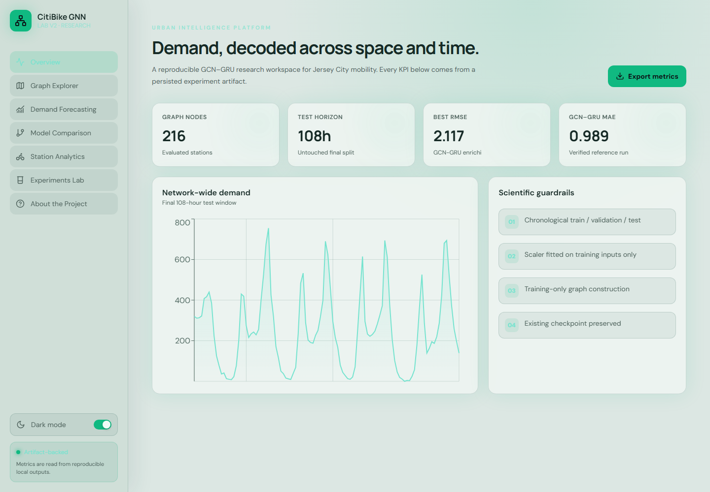
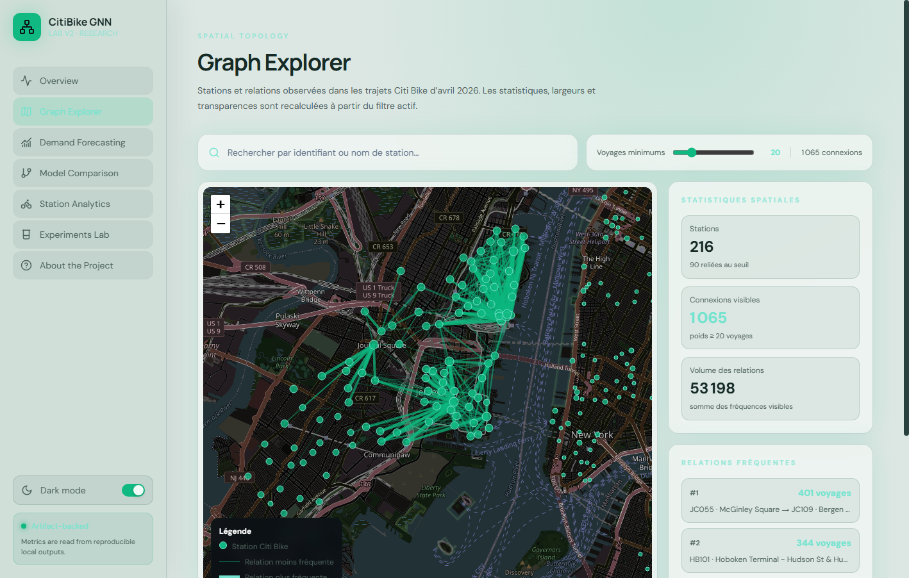
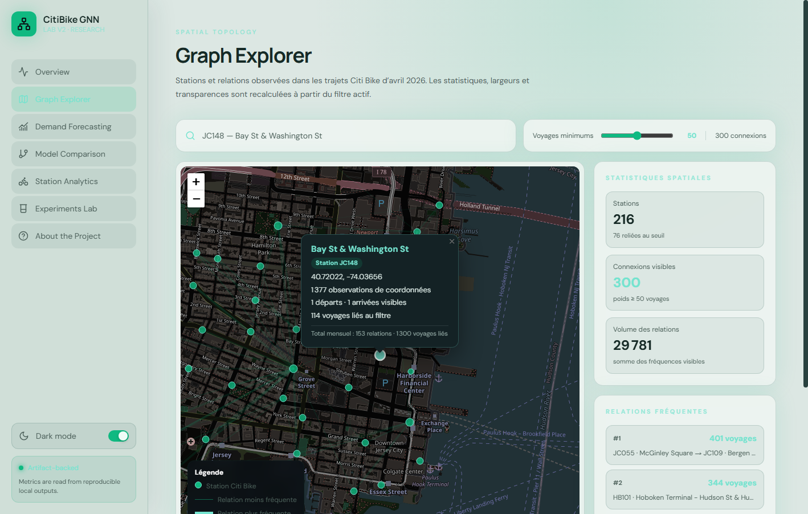

# CitiBike GNN Lab v2

**Intelligent Urban Mobility Forecasting with Spatio-Temporal Graph Neural Networks**

CitiBike GNN Lab v2 is an applied research platform for one-hour-ahead station-demand forecasting. It combines a leakage-safe PyTorch/PyTorch Geometric experiment pipeline, a FastAPI artifact and training API, and a React analytics workspace.

> The project does not claim that a GNN automatically beats a simple baseline. On the controlled reference split, GCN–GRU has a slightly better RMSE while persistence has a better MAE.

## Verified reference results

These values come from `outputs/reproducible_comparison.csv`. The original checkpoint remains at `outputs/models/gcn_gru_retrained.pth`.

| Model | MAE | RMSE |
|---|---:|---:|
| Naive persistence | **0.8377915** | 2.1382875 |
| GCN–GRU + calendar | 0.9886128 | **2.1170790** |

Notebook metrics use a different cutoff and are not mixed into this controlled comparison.

## Architecture

```text
April 2026 Citi Bike trips
        │
        ├── hourly departures + arrivals ── calendar cycles
        │                     │
        │              chronological split
        │                     │
        ├── training-only station graph (binary or trip-weighted)
        │                     │
        └──────────── GCN → GRU → station demand ────────┐
                                                         │
                     experiment JSONL + versioned checkpoints
                                                         │
                 FastAPI ─────────────── React dashboard
```

The graph convolution learns spatial interactions between stations. The GRU learns the temporal evolution of each station's graph representation. A graph-free GRU and persistence are methodological controls.

## Scientific protocol

- Target: departures + arrivals for the next hour.
- Histories: 6, 12, or 24 hours.
- Split: chronological 70% training, 15% validation, 15% test.
- Normalization: fitted only on training inputs.
- Graph: constructed only with trips ending before the validation boundary.
- Selection: early stopping and scheduler use validation loss.
- Test: reserved for final evaluation.
- Reproducibility: seed and complete configuration stored with every v2 run.
- Losses: MSE, MAE, Huber, or peak-weighted MSE.

## Dataset

The local reference dataset is Jersey City Citi Bike trip data for April 2026. Raw data is ignored by Git and must not be committed.

```text
data/raw/JC-202604-citibike-tripdata.csv
```

## Windows 11 installation

Python 3.11 is recommended. PyTorch is not available for every newer Python release.

```powershell
py -3.11 -m venv .venv
.\.venv\Scripts\Activate.ps1
python -m pip install --upgrade pip
pip install -r requirements-dev.txt
cd frontend
npm install
cd ..
```

Validation:

```powershell
.\.venv\Scripts\python.exe -m pytest -q
cd frontend
npm run lint
npm test
npm run build
```

Start both applications and open the product in Google Chrome:

```powershell
.\scripts\start-dev.ps1
```

Manual startup:

```powershell
.\.venv\Scripts\python.exe -m uvicorn api.main:app --reload
cd frontend
npm run dev
```

API docs: `http://127.0.0.1:8000/docs`  
Application: `http://127.0.0.1:5173`

## Experiments

```powershell
.\.venv\Scripts\python.exe scripts\run_experiment.py --name gcn_gru_h12_huber --history 12 --loss huber --graph weighted --epochs 20 --seed 42
```

The Experiments Lab submits the same real runner through a serialized background queue. It never displays planned configurations as completed runs. New checkpoints use a configuration/seed name and do not overwrite the original.

## API

| Endpoint | Purpose |
|---|---|
| `GET /api/overview` | Verified KPIs and controlled metrics |
| `GET /api/stations` | Coordinates derived from raw trips |
| `GET /api/graph` | Observed weighted station links |
| `GET /api/models` | Available local checkpoints |
| `GET /api/predictions` | Aligned hourly reference predictions |
| `GET /api/stations/{id}` | Local station evaluation |
| `GET/POST /api/experiments` | Experiment history / background run |
| `GET /api/downloads/{file}` | Allow-listed result exports |

## Interactive workspace

- **Graph Explorer:** real station identifiers, names and averaged coordinates from the April trip file; weighted directed relations; minimum-trip filtering; spatial summaries; frequent-relation ranking; station search, map centering and interactive popups. OpenStreetMap attribution remains visible.
- **Demand Forecasting:** aggregate observed, GCN–GRU and persistence series over selectable 24-hour, 48-hour or complete test windows. The interface explicitly reports that no station-level hourly prediction artifact is available.
- **Model Comparison:** controlled MAE/RMSE comparison with metric-specific winners and measured deltas.
- **Station Analytics:** real station selection, coordinates, activity and local MAE comparison for the shared final test window.
- **Experiments Lab:** validated configuration of history, architecture, loss, graph, epochs, patience and seed, submitted to the serialized real training queue.

## Product screenshots

### Research overview



### Graph Explorer



### Real station inspection



## Contributing

Contributions are welcome when they preserve the chronological evaluation protocol and the distinction between verified and planned results. Read [CONTRIBUTING.md](CONTRIBUTING.md) before opening a pull request.

## Author

**Douaa EL ARIF** — Information Systems and Communication Engineering student at ENSA El Jadida.

- [GitHub](https://github.com/douaaelarif12)
- [LinkedIn](https://www.linkedin.com/in/douaa-e-71413223b/)

## Structure

```text
api/                 FastAPI routes, schemas, artifact service, job queue
frontend/            React + TypeScript + Vite + Tailwind dashboard
scripts/             experiment and Windows development entry points
src/                 preprocessing, graph, models, training, utilities
tests/               leakage, tensor shape, model and API tests
data/raw/            local dataset (not committed)
outputs/              verified metrics, predictions, figures, checkpoints
backups/              local pre-refactor snapshot
```

## Limitations

- Only one month and one service area are represented.
- Demand peaks and some local stations remain difficult to forecast.
- Weather, events, holidays, bike availability, and capacity are absent.
- Existing v1 results are single-seed results.
- Multi-seed v2 conclusions require executing the experiment matrix; no unexecuted metrics are claimed.

## Portfolio summary

An end-to-end spatio-temporal forecasting platform combining PyTorch Geometric, GCN–GRU modeling, controlled baselines, experiment tracking, FastAPI, and an interactive React geospatial dashboard. The reference GCN–GRU improves RMSE slightly over persistence, while persistence remains stronger on MAE—an honest result that motivates deeper peak and station-level analysis.

## License and data

The source code is available under the [MIT License](LICENSE). Follow Citi Bike's data terms and do not publish local checkpoints or raw datasets without verifying redistribution rights.
